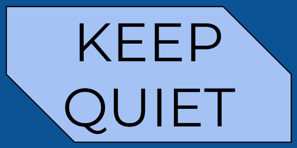

- 👋 Hi, I’m @MatyBelo 

- :computer: &nbsp;Connect with me on **[LinkedIn]**

[linkedin]: https://www.linkedin.com/in/matias-belo "Matias Belo LinkedIn"

I have taken part in the 2026 Hackathon at UBA. We made a game:

<!---
MatyBelo/MatyBelo is a ✨ special ✨ repository because its `README.md` (this file) appears on your GitHub profile.
You can click the Preview link to take a look at your changes.
--->
